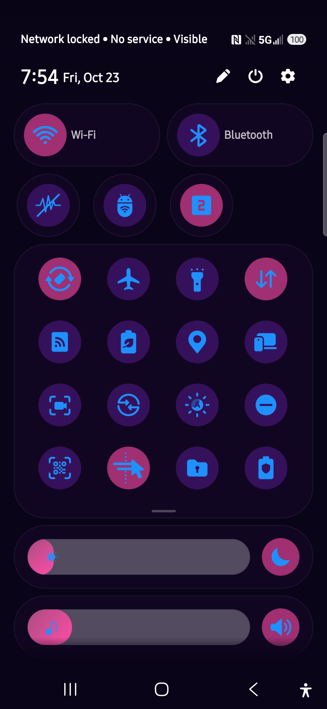

# A1 Theme Park — CyberPop

A cyberpunk palette for the **Samsung quick panel** (the pull-down notification
shade), built with Samsung's own **Theme Park** app on a Galaxy A26 5G.

This repo is a backup of the palette plus the evidence that it works. Theme
Park stores themes in its private app data and the applied overlay lives at
`/data/resource-cache/…frro`, which is root-owned and unreadable without root —
so the durable record is the seven colour values and the steps, not a theme
file.



## Device this was built on

| | |
|---|---|
| model | SM-S266V (Galaxy A26 5G, TracFone/TFN) |
| OS | Android 16, One UI 8.5 (`80500`) |
| build | `BP4A.251205.006` / `S266VUDSACZH3` |
| Theme Park | `com.samsung.android.themedesigner` **1.1.02.2** (versionCode `110202000`) |
| bootloader | locked (`flash.locked=1`, `verifiedbootstate=green`) — no root |

Theme Park 1.1.00.21 and older have **no Quick panel tab** at all. 1.1.02.2 is
the first build with a real quick-panel editor. The APK is Samsung-signed and is
not redistributed here.

## The format, and what it cannot do

Theme Park's Quick panel editor exposes exactly **seven colour slots**. There is
no per-row, per-tile or per-icon targeting — a "theme" is seven values, full
stop. So:

- **You cannot colour icons individually or per row.** The two glyph slots are
  *active* and *inactive*; every icon in a given state shares one colour.
- **There is no glow, blur or drop-shadow.** The icon-pack tab has Basic /
  Emboss / Glass / Gradient / Duotone / Film Grain — no Glow. The `Glow` and
  `Shadow` strings inside `resources.arsc` belong to other screens. A real blur
  would mean replacing SystemUI drawables, which needs root.
- What reads as a "glow" here is **contrast**: a bright glyph on a dark disc.

## The seven slots

Positions are for a 1080×2340 display and are the tap targets in the editor.

| # | slot | tap | what it controls |
|---|---|---|---|
| 1 | background | `223,1150` | the shade's base colour |
| 2 | on-disc | `361,792` | disc behind an enabled tile (accepts alpha) |
| 3 | off-disc | `856,971` | disc behind a disabled tile (accepts alpha) |
| 4 | sliders | `428,1459` | brightness/volume track and knob |
| 5 | card | `577,1294` | container tint behind the tile grid — **6-digit only** |
| 6 | active glyph | `335,648` | icon colour on enabled tiles — **6-digit only** |
| 7 | inactive glyph | `808,806` | icon colour on disabled tiles **and** inactive pill labels — **6-digit only** |

Slot 7 was identified by experiment: setting it to cyan turned every off-tile
glyph cyan while slot 6 stayed untouched.

## CyberPop

Three colours doing all the work: **purple** base, **bright blue** glyphs,
**bubble-gum pink** for lit tiles and sliders.

| slot | value |
|---|---|
| background | `FF0A0418` |
| on-disc | `99FF4DA6` |
| off-disc | `4D8A2BE2` |
| sliders | `FFFF4DA6` |
| card | `8A2BE2` |
| active glyph | `1E90FF` |
| inactive glyph | `1E90FF` |

Hex is `AARRGGBB`. The alpha on the discs is what keeps the blue glyphs legible:
at full opacity the pink disc out-luminates the blue icon and both turn to mush.

## How to apply

1. Install Theme Park **1.1.02.2** and enable it
   (`adb shell pm enable com.samsung.android.themedesigner` — sideloaded Good
   Lock modules land disabled).
2. Open it → **Quick panel** tab → **Create new**.
3. Tap each of the seven slots in the order above and enter the value.
   - The picker's hex field is at `770,686`; **OK is at `762,2103` and the
     keyboard covers it** — press `KEYCODE_BACK` once to hide the IME first.
   - Slot taps need ~2 s before the dialog is reliably readable.
4. Save under a new name. **An applied theme cannot be overwritten** — you get
   *"The current theme cannot be overwritten. Please save it under a different
   name."* The right-hand button reads `Overwrite` (disabled) and becomes `OK`
   once the name changes.
5. Select the theme → **Apply**.

## Traps worth knowing

- **6-digit slots truncate silently.** Card, active glyph and inactive glyph
  keep only the first six characters, so `FF120A1E` becomes `FF120A` — a pale
  pink, not near-black. Use six digits on those three; the two discs and the
  sliders accept eight.
- **Lock rotation while driving the editor.** The theme list and the picker
  desync badly in landscape. `settings put system accelerometer_rotation 0`
  first, restore to `1` after.
- **Collapse the shade first** (`cmd statusbar collapse`) or taps land on
  `NotificationShade`.
- **Editing the light-mode variant is separate.** Toggle the moon/sun at
  `877,186`. If only dark mode is themed, switching to light reverts to the
  stock lavender panel.
- **Main preview labels** ("Telecom", "Wi-Fi") are drawn by the preview mock in
  a fixed pale colour and do not respond to any slot. "Telecom" is a fake
  carrier name in that mock — it is not on the real shade and it is not a theme
  name.
- Notification cards keep a faint tint of the wallpaper behind them; the
  quick-panel editor exposes no notification-card colour.

## Other palettes tried

Kept for reference — each was applied to the device and captured.

| name | look | screenshot |
|---|---|---|
| **CyberPop** | purple base, blue glyphs, pink lit tiles + sliders | `screenshots/cyberpop-expanded.png` |
| **CyberNeon4** | near-black violet, dark green/maroon discs, all glyphs electric blue | `screenshots/cyberneon4-blue-on-dark.png` |
| **A1Duotone** | icons split by state: electric yellow on, cyan off | `screenshots/a1duotone-yellow-cyan.png` |
| **A1Ice** | navy base, teal discs, white/ice glyphs, cyan container | `screenshots/a1ice-white-teal.png` |
| **CyberNeon2** | bright green/pink discs, white glyphs — maximum saturation | `screenshots/cyberneon2-bright.png` |

Exact values for the first four are in [`palettes.json`](palettes.json).
`CyberNeon2`, `CyberNeon3` and the original `CyberNeon` predate this record and
their slot values were not captured — the screenshots are all that survives of
them.

## Verification

Every screenshot here is `adb exec-out screencap -p` of the **real** shade on
the device, expanded — not a Theme Park preview. The applied overlay was
confirmed live:

```
adb shell cmd overlay list | grep -i themepark
[x] android:ThemePark_dummy
[x] android:ThemePark_NotificationPanel
```

`cmd overlay dump android:ThemePark_NotificationPanel` reports
`mTargetPackageName: com.android.systemui`, `mIsFabricated: true`,
`mState: STATE_ENABLED` — so it is a fabricated RRO over SystemUI, which is why
it survives a reboot.

## Licence / provenance

The colour values and the text here are mine to give away. Samsung's Theme Park
APK, the overlay and the phone's firmware are Samsung's and are deliberately
**not** included.
